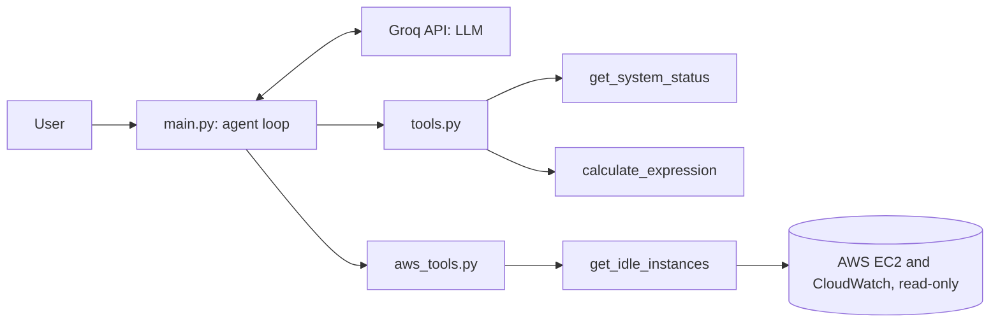

# AI Agent Core (Groq)

A small AI agent built in Python with the Groq API that finds idle AWS EC2 instances and explains in plain English what is wasting money. It runs in the terminal, and the LLM itself decides which tool to call (tool calling), then loops until it has an answer.

This is a **learning project**. The agent reads EC2 data from a real AWS account through a read-only IAM user, so it can look at instances but never change anything.

## How it works



1. The user message is added to the conversation history.
2. The model receives the tool catalog and decides: answer directly, or call a tool.
3. If it calls a tool, the code runs the matching Python function and sends the result back to the model.
4. The loop repeats until the model replies without a tool call.

## Tools

| Tool | What it does |
|---|---|
| `get_system_status` | Returns the OS info and current time of the machine |
| `calculate_expression` | Evaluates a math expression safely, using `ast` instead of `eval` |
| `get_idle_instances` | Returns running EC2 instances with their average CPU over the last 24 hours, using `boto3` |

## Example

```
You: which of my AWS instances are wasting money?
🔧 Agent chose: get_idle_instances({})
AI: Instance i-0e22... (t3.micro) has an average CPU of 0.3% over the past 24 h, so it is idle and likely wasting money.

You: how much would I save per month if I stop it?
AI: I don't have the monthly cost for that instance, so I can't calculate the exact savings.
```

## Setup

```bash
git clone https://github.com/achh-914/ai-agent-core-groq.git
cd ai-agent-core-groq
python3 -m venv .venv
source .venv/bin/activate
pip install -r requirements.txt
echo "GROQ_API_KEY=your_key_here" > .env
export AWS_PROFILE=your-readonly-profile
python main.py
```

Use an IAM user with only `AmazonEC2ReadOnlyAccess` and `CloudWatchReadOnlyAccess`. The `.env` file is listed in `.gitignore`, so the API key is never committed.

## What I learned

- The model only knows what the system prompt and the tools tell it. With no role defined, it invented a past project. A clear system prompt fixed that, and it now says when it does not have the data (like the instance cost).
- Never trust the model's output blindly: it sometimes passes invalid arguments to a tool. The code now keeps only the arguments the function accepts, and returns tool errors to the model instead of crashing.
- Registering a tool takes four changes: the function, the tool catalog, the function map, and the prompt.

## Next steps

- Add the monthly cost of each instance, so the agent can estimate savings
- Add tests for the tools
