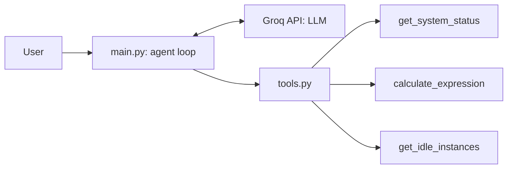

# AI Agent Core (Groq)

A small AI agent built in Python with the Groq API. It runs in the terminal, and the LLM itself decides which tool to call (tool calling), then loops until it has an answer.

This is a **learning project**: the AWS data is sample data, not a real account.

## How it works



1. The user message is added to the conversation history.
2. The model receives the tool catalog and decides: answer directly, or call a tool.
3. If it calls a tool, the code runs the matching Python function and sends the result back to the model.
4. The loop repeats until the model replies without a tool call.

## Tools

| Tool | What it does |
|---|---|
| `get_system_status` | Returns the OS info and current time of the machine |
| `calculate_expression` | Evaluates a math expression safely, using `ast` instead of `eval` |
| `get_idle_instances` | Returns sample AWS EC2 instances with average CPU and monthly cost |

## Example

```
You: which of my AWS instances are wasting money?
🔧 Agent chose: get_idle_instances({})
AI: Instances i-0a1 and i-0c3 have CPU averages below 5% and are likely idle...

You: how much would I save per month if I stop the idle ones?
🔧 Agent chose: calculate_expression({'expression': '140+360'})
AI: Stopping those idle instances would save you $500 per month.
```

## Setup

```bash
git clone https://github.com/achh-914/ai-agent-core-groq.git
cd ai-agent-core-groq
python3 -m venv .venv
source .venv/bin/activate
pip install -r requirements.txt
echo "GROQ_API_KEY=your_key_here" > .env
python main.py
```

The `.env` file is listed in `.gitignore`, so the API key is never committed.

## What I learned

- The model only knows what the system prompt and the tools tell it. With no role defined, it invented a past project. A clear system prompt fixed that.
- Registering a tool takes four changes: the function, the tool catalog, the function map, and the prompt.

## Next steps

- Connect `get_idle_instances` to real AWS with `boto3` (read-only permissions)
- Add error handling for failed tools and API errors
- Add tests for the tools
