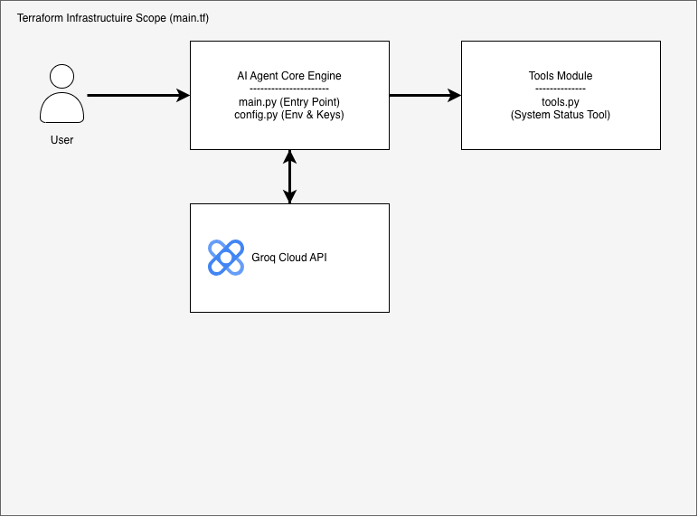

# AI Agent Core (Groq & Llama 3)

An intelligent AI Agent core infrastructure built with Python and Groq Cloud API, managed with Terraform Infrastructure as Code.

## 📐 System Architecture

## 🛠️ Tech Stack
- **Language**: Python
- **LLM Provider**: Groq Cloud API (Llama 3)
- **IaC**: Terraform
